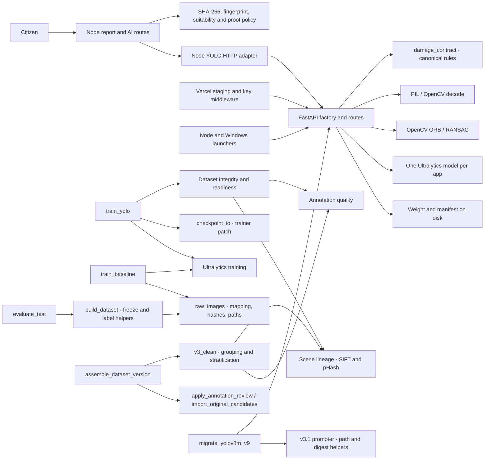
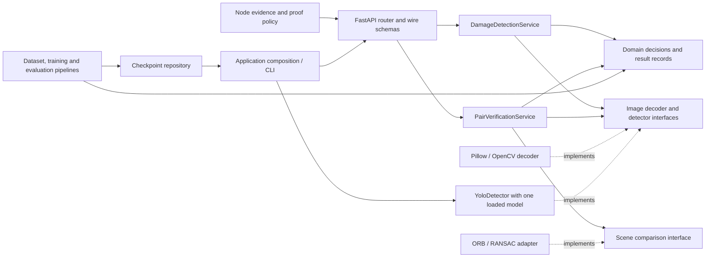

# NeighborLens Python AI architecture audit

**2026-11-16 · Branch `fine-tuning/neighborlens_final_v2/13-11-2026` · HEAD `14f742c`**

The production app already loads one YOLO model per FastAPI app instance. Both prediction routes reuse it. A `YoloDetector` object would make ownership and injection explicit. The largest verified runtime costs come from model calls and image work inside async handlers, including an embedding pass whose output single prediction discards. Keep YOLOv8m v9 and its configuration fixed through the extraction.

This audit covers all **50 Python files** under `ai/`, including the untracked v9 migration command and its tests. References were checked in Python, Node, the Citizen frontend, launchers, CI, current and historical docs, and local run artifacts. “No caller found” means none in these sources. It leaves room for operator scripts or notebooks outside the checkout. No implementation was refactored. The working tree already contained unstaged Citizen evidence and migration work, and two staged `.idea` files, before this audit.

## Ranked findings

| Priority | Finding | Evidence and impact |
| --- | --- | --- |
| High | Vercel's staged package and test fixture are coupled to the active developer checkpoint. | The build copies first, then compares the staged weight against the old YOLO11s pin. The active v9 weight fails that pin and its manifest is absent from the staging list. Both Vercel route tests fail at setup today. Adding new modules without changing the staging allowlist would cause a second packaging failure. Run contract tests with an isolated staging root and exercise the checksum guard separately. [Build](../inference-vercel/build.py#L9) · [Test fixture](tests/test_vercel_inference_entrypoint.py#L35) |
| High | The FastAPI model API can emit positive damage for unsuitable evidence when called directly. | Live `/predict` returned `broken_streetlight` at **0.5700** for the Camo Studio crop. The Citizen Node flow rejects this crop and recompressed duplicates before provider calls, and checks the submitted bytes again before persistence. Python checks MIME allowlisting, decoding and resource limits, plus exact SHA-256 equality on the pair route. Vercel adds an inference-key boundary. Preserve Node as the evidence authority and keep raw inference behind the existing trust boundary. [FastAPI](inference/inference_api.py#L340) · [Vercel entry point](../inference-vercel/app.py#L21) · [Node evidence gate](../server/application/use-cases/reportEvidence.js#L4) · [Report persistence](../server/application/use-cases/report.service.js#L326) |
| High | The active training lineage and guarded research training command serve different workflows. | The v9 `experiment.json` matches the `train_baseline.py` writer and argument shape. That path records hashes if present and goes directly to `model.train`. `train_yolo.py` enforces the v3.1 dataset readiness gate by default and installs atomic checkpoint callbacks. Older phase runners can evaluate test as part of training. An orchestration cleanup must preserve experiment identities and independent evaluation policy. [Baseline trainer](training/train_baseline.py#L63) · [Guarded trainer](training/train_yolo.py#L145) · [E-2 runner](training/run_phase3_e2.py#L111) |
| Medium–High | Synchronous work in async handlers delays unrelated requests on one worker. | After the multipart reads, PIL/OpenCV, ORB/RANSAC, detection and embeddings run synchronously. Live pair requests raised overlapping health latency to **120–395 ms** from **2–18 ms** idle in five trials. Unbounded thread offload would introduce a different risk because Ultralytics changes shared predictor arguments before inference. Measure a bounded, serialized model adapter before changing the worker model. [Decode](inference/inference_api.py#L122) · [Single](inference/inference_api.py#L340) · [Pair](inference/inference_api.py#L372) |
| Medium | Extra single-image work is confirmed; pair work can multiply across the application. | `/predict` builds a BGR image and discards it, then runs and discards an embedding. Each pair uses ORB plus two predictions and two embeddings. Node preview uses two single calls for ordered proofs. Report creation can request pair verification and, depending on its assessment, repeat best-effort detection. Preserve preview and submit independence initially. Optimize discarded work under a separate compatibility check. [Adapter candidate](inference/inference_api.py#L184) · [Node preview](../server/application/use-cases/damageDetection.service.js#L67) · [Submission](../server/application/use-cases/report.service.js#L351) |
| Medium | Manifest verification occurs after loading the model. | `YOLO(weights)` runs before `describe_model` verifies the checksum. An existing JSON array or scalar also falls through as if the manifest were missing. That is a trust and drift risk for the local operator path. Separate format parsing, pin verification and trusted checkpoint loading. Preserve legacy manifest absence, and add a test that rejects an invalid configured manifest before invoking the loader. [Model factory and metadata](inference/inference_api.py#L263) |
| Medium | Open-ended fallbacks hide distinct pipeline failures. | All decode exceptions become 400, all embedding exceptions become an empty vector, and alignment and comparison failures log warnings without the exception type. Model agreement can remain valid with scene state `UNAVAILABLE`, as intended. Retain that external behavior while making decode failures and advisory degradation observable. [Decode](inference/inference_api.py#L122) · [Embedding fallback](inference/inference_api.py#L217) · [Scene fallback](inference/inference_api.py#L393) |
| Medium | Dataset lineage checks scale quadratically and write safety differs across historical builders. | Scene grouping does all-pairs pHash and SIFT, materializes pairs and chunks, and starts two process pools. The gate also enumerates cross-split pairs and candidate import compares reference and candidate content. For 7,644 images, a full pair enumeration alone has about 29.2 million entries. The legacy v2 restratifier clears destination split directories and v3 has a force-delete branch. Decide lineage policy first, then compare any sound candidate pruning against the exhaustive implementation on frozen copies. [Lineage](preprocessing/scene_lineage.py#L120) · [Gate](preprocessing/dataset_integrity_gate.py#L63) · [Old v2 writes](preprocessing/restratify_dataset_v2.py#L246) · [Old v3 writes](preprocessing/build_neighborlens_v3.py#L114) |
| Low–Medium | Legacy detector surfaces use different class and confidence policies, and one CLI target is broken in this layout. | The old scan API filters legacy names, defaults to a root `best.pt`, loads per request and points Uvicorn at `ai.scan_infrastructure_api:app`. The file lives in `ai/inference/`. The monitored production launcher calls only `ai.inference.inference_api`. Preserve a compatibility path if an external caller is established. [Legacy scanner](inference/scan_infrastructure_api.py#L39) · [Legacy CLI](inference/scan_infrastructure_api.py#L110) · [Active launcher](../scripts/start-ai.js#L20) |

The production detector keeps `severity_level` null. The pair code still ranks severities, although its current detector cannot supply one. Treat that as a compatibility field and retain null output until a separately approved severity contract exists. Also confirm whether `summary.alignment.good_matches_count` should keep the existing semantics: on the successful homography path it contains the inlier count, while early exits can return the count before RANSAC. A schema cleanup must preserve the observed values. [Pair serialization](inference/inference_api.py#L434) · [Alignment](inference/inference_api.py#L167)

## Current dependencies



The Citizen preview sends a paired multipart request to Node. Node validates both inputs together, requests single predictions for accepted evidence, signs per-photo claims and returns model metadata. On submission Node rechecks evidence, hash/order and proof ownership, jurisdiction and GPS through the existing use case, then persists or routes to manual review. Node's pair provider uses the separate FastAPI pair route for advisory scene/verification data. A scene `MATCH` neither establishes different views nor changes low-confidence or class-disagreement handling. [Browser request](../frontend/js/citizen/yoloDamageDetector.js) · [AI controller](../server/presentation/http/controllers/ai.controller.js#L21) · [Node provider](../server/infrastructure/ai/index.js#L8) · [Report service](../server/application/use-cases/report.service.js#L210)

### Entry-point classification

| Status | Verified callers and entry points |
| --- | --- |
| Active local runtime | `npm run ai` → `scripts/start-ai.js` → `python -m ai.inference.inference_api`. The Windows batch launcher runs the file directly. Both use the existing production path unless configured otherwise. Node uses `/predict` plus `/api/v1/damage/verify-pair`; `/verify-pair` and `/api/health` remain compatibility aliases. |
| Remote packaging and CI | `inference-vercel/app.py` calls `create_app`. Its build stages two Python files plus the checkpoint. `.github/workflows/qa.yml` runs all `ai/tests`. The audit exercises the local build fixture and does not establish deployed service state. |
| Active local release tooling | `python -m ai.training.migrate_yolov8m_v9 check\|promote\|rollback` is the documented and used v9 path. The v3.1 promoter has tests and supplies three helpers to the v9 command. Keep that dependency until helpers are extracted. |
| Current research tooling | `python -m ai.training.train_yolo` is the maintained guarded command for eligible retraining with the v3.1 workflow. `python ai/training/train_baseline.py` is the best-supported v9 provenance match. `python ai/training/evaluate_test.py` is the established separate frozen-test evaluator. Preserve both packaging and dataset layout conventions. |
| Supported dataset workflow | `data/review/task1_6/README.md` documents annotation review and gate invocations. Remediation, candidate import, scene lineage and split assembly have direct import or regression-suite callers. The earlier audit/build/freeze path also has docs and CLI subprocess coverage. |
| Historical or standalone | Phase 2, E-2, E-3 and 4E are explicit research recipes. Legacy scan, detector, monitor and ResNet comparator have manual interfaces and no verified production callers. `image_similarity.py` is a documented standalone CLI with tests. README describes it alongside the two-photo feature, while the active pair route implements different behavior. |

## Full Python inventory

Each row gives the public entry points or API groups, dependencies and callers, then the principal defect or coverage gap. Actions are proposals. **ARCHIVE** means retain historical behavior and move only after call-site verification and compatibility planning. Unused names are verified static candidates. Broad catches and side effects are called out where found. No general-purpose whole-program dead-code or line-coverage run was used.

### Detection · 3 files

| File and public surface | Use, audit and next action |
| --- | --- |
| [damage_categorizer.py](detection/damage_categorizer.py#L31) · `DamageCategorizer.map_class_id/from_prediction/categorize_batch` | Typing-only legacy class-ID dictionary and conversion. No caller or direct tests found. Stateful-looking API wraps mapping, with a taxonomy distinct from `damage_contract`. **ARCHIVE** after locating any notebook callers. Characterize unknown IDs and legacy values if retained. |
| [infrastructure_detector.py](detection/infrastructure_detector.py#L57) · `process_file`, `build_summary`, CLI | Standalone image/video processing, annotation and JSON with OpenCV and Ultralytics. No active web caller. Loads per invocation of `process_file`; repeated caller use repeats loading. `os` unused. **ARCHIVE** behind its CLI or inject one model if still used. No direct image, video or malformed-media regression. |
| [infrastructure_monitor.py](detection/infrastructure_monitor.py#L94) · dataset preparation, ResNet, YOLO loading/training/detection, annotation, reporting, `verify_same_defect`, CLI | Legacy all-in-one tool with cv2, Torch, torchvision and YOLO. ResNet is cached, YOLO loads in separate wrappers. Legacy fallback weights/taxonomy, model/training/report side effects and broad logging fallbacks around embeddings and individual results. `Tuple` unused. **ARCHIVE** as a legacy workflow, extracting only proven common utilities. No direct contract or write-safety fixtures. |

### Inference · 5 files

| File and public surface | Use, audit and next action |
| --- | --- |
| [compare_damage_instances.py](inference/compare_damage_instances.py#L146) · image guidance/validation, `detect_crops_by_class`, ResNet embedding, cosine, `compare_damage_images`, CLI | Standalone OpenCV/torchvision/Ultralytics crop comparator with no active HTTP caller or tests found. Uses per-comparison YOLO loading and a pretrained ResNet, policy and features differ from ORB/full-frame v9. **ARCHIVE** after checking research use. Verify crop pairing, weights availability and download-free offline behavior if retained. |
| [damage_contract.py](inference/damage_contract.py#L34) · canonical maps, `validate_model_names`, `is_eligible`, `decide`, `decide_pair`, `release_label` | Active, pure stdlib contract used by FastAPI and promotion tools. Domain rules currently share a file with release display labels and manifest filename. Unit and fake-HTTP coverage enforce thresholds and classes. **KEEP / EXTRACT** domain and release metadata separately, with re-exports. Add tie/multiple-box and result-shape parity on refactor. |
| [image_similarity.py](inference/image_similarity.py#L151) · `SimilarityResult`, `ImageSimilarityError`, path validation and cosine, `check_image_match`, `compare_damage_images`, CLI | Documented standalone PIL/ImageHash/Torch helper. pHash fast path can bypass loading; otherwise optional injection can reuse a model, default creates one. Letterboxes independently and uses cosine policy distinct from the live route. Existing tests cover both branches and corrupt input. **KEEP** CLI, consolidate only proven math. Add real-vector and stable CLI JSON cases. |
| [inference_api.py](inference/inference_api.py#L316) · five Pydantic types, decode, alignment, prediction/embedding, cosine, metadata, `create_app`, `main` | Active FastAPI/Pillow/OpenCV/NumPy/Ultralytics boundary. Loads once per app; manages I/O, decision, serialization, provenance and CLI together. Unused `Field` and `CANONICAL_CLASSES`; import fallback and module logging side effect; broad decode/scene/embed fallbacks. Fake-model HTTP coverage plus this live baseline. **EXTRACT** by dependency, adding staging, call-count, concurrency and manifest-order coverage before optimizations. |
| [scan_infrastructure_api.py](inference/scan_infrastructure_api.py#L65) · three response types, `load_model`, `validate_image`, `scan_infrastructure` | Legacy FastAPI/PIL/YOLO endpoint with broken module launch string, per-request loading, broad decode catch and legacy filtering. No verified web consumer or direct tests. **ARCHIVE / INVESTIGATE** any external client before fixing or wrapping its CLI. Compare compatible response taxonomy if retained. |

### Preprocessing · 17 files

| File and public surface | Use, audit and next action |
| --- | --- |
| [annotation_quality.py](preprocessing/annotation_quality.py#L29) · label parsing, geometry, IoU, box and dataset audits/statistics | Active gate/review/import dependency. Uses scene-lineage constants, so annotation logic imports the OpenCV lineage stack. Duplicates canonical map and parser concepts with different issue reporting. Tested via gate/remediation. **EXTRACT** pure geometry and names. Add property/boundary cases for IoU, nonfinite values and malformed rows. |
| [apply_annotation_review.py](preprocessing/apply_annotation_review.py#L65) · review/scene/load/write helpers, background selection, `apply_review`, `split_report`, CLI | Documented active v3.1 review workflow; YAML, filesystem, annotation audit and lineage constants. Mixes decision rules, copy/write and reporting. Tests cover correction, quarantine and train-only background cap. **REFACTOR** pure decisions and staged publication; characterize rerun and partial-write failures. |
| [assemble_dataset_version.py](preprocessing/assemble_dataset_version.py#L22) · `assemble`, CLI | Active tested assembly of base and accepted originals. Reuses split rules from a builder and reporting from a review CLI; YAML/copy operations share orchestration. **EXTRACT** split and report helpers. Keep frozen split/background coverage and add failed-copy/output-exists characterization. |
| [audit_raw_images.py](preprocessing/audit_raw_images.py#L41) · `inspect_image`, duplicate/resolution/quality checks, manifest/report writers, `verify`, CLI | Documented original audit pipeline, subprocess-tested. Pillow/raw helpers; per-folder pair comparisons, reporting and CLI mixed, separate dHash policy. **KEEP / EXTRACT** pure checks while preserving CSV and verification hashes. Profile pair scaling and add cross-platform path/error fixtures. |
| [audit_yolo_dataset.py](preprocessing/audit_yolo_dataset.py#L55) · `compute_sha256`, `compute_64phash`, `hamming_dist`, `audit_dataset`, CLI | Historical documented audit path and dedicated tests. NumPy/OpenCV; duplicated SHA/pHash implementation with v2 restratifier and its own dataset-layout assumptions. Unused `os`, `glob`. **CONSOLIDATE** identical hash helpers only after digest/threshold characterization. Add explicit unreadable-image and alternate-layout cases. |
| [build_dataset.py](preprocessing/build_dataset.py#L45) · `LabelError`, `UnionFind`, labels, manifest intake, dedupe/group/split/copy/freeze/hash, CLI | Earlier documented builder still supports frozen evaluation and tests. Pillow, YAML and raw helpers via script-directory imports. Policy, image conversion, copy and rendering share one module. Parser/dHash grouping differ from later scene tooling. **KEEP / EXTRACT** freeze format and shared geometry. Add fault-injected writes and check packaging-independent imports. |
| [build_neighborlens_v2.py](preprocessing/build_neighborlens_v2.py#L134) · enclosing box, integrity checks, `run_build`, CLI | Historical Phase 4D legacy ledger. `--execute` success branch is a stub that never compiles data. `os`, `shutil`, `numpy` unused. No direct write-path tests. **ARCHIVE / INVESTIGATE** that advertised command and retain historical gate evidence. Do not treat the stub as an alternate active builder. |
| [build_neighborlens_v3.py](preprocessing/build_neighborlens_v3.py#L97) · hash, candidate matching, merge geometry, `build_v3_dataset`, CLI | Historical road-review v3 recipe. Imports the external-in-tree `validate_decisions` via `sys.path` and Ultralytics dataset checker; force path can delete prior output. Duplicates digest code, `os` and `defaultdict` unused. Road ledger tests cover dependency, not entire builder. **ARCHIVE** with a compatibility entry point, characterize dry run, force and frozen split constraints first. |
| [build_neighborlens_v3_clean.py](preprocessing/build_neighborlens_v3_clean.py#L32) · scene/class grouping, split, safe fixes, label/YAML format, `build`, CLI | Active library caller is assembly; v3_clean is review input. Connects scene and annotation reports, frozen groups, output and CLI. Tests cover seed determinism, per-class coverage and safe fixes. **EXTRACT** split policy without changing tie/order behavior. Add fixture comparison for complete generated manifests. |
| [dataset_integrity_gate.py](preprocessing/dataset_integrity_gate.py#L133) · `GateResult`, manifest and split checks, `run_gate`, `assert_dataset_ready`, CLI | Active documented guard hit by `train_yolo`. YAML, annotation and scene utilities. I/O, policy and all-pairs candidate enumeration combined. Imported `roboflow_stem` has no local use. Strong tests include leak, review, class support and multiprocessing. **REFACTOR** gate I/O and pair enumeration independently. Verify error codes and exhaustive parity. |
| [import_original_candidates.py](preprocessing/import_original_candidates.py#L126) · provenance/label validation, reference loading, stable IDs, `run_import`, reports/CLI | Active pipeline and test caller, with PIL, annotation and scene lineage. Repeats hashing/comparison loops, combines acceptance decisions, copy and reports. Tests cover stable IDs, duplicates and allowed quarantine reentry. **EXTRACT** shared lineage service with the current ordered acceptance and review reasons intact. Add missing-provenance and write-failure parity. |
| [prepare_user_images.py](preprocessing/prepare_user_images.py#L27) · `stage_category`, CLI | Historical documented three-category intake, stdlib file copy and CSV. Does not label; can replace a same-name staged target and rewrites the manifest. No direct regression or current production/research caller found. **ARCHIVE** and retain explicit opt-in command if operators use it. |
| [raw_images.py](preprocessing/raw_images.py#L24) · `ClassMapping`, mapping load, digest, dHash, Hamming, file iteration | Active shared helpers for older audit/build, baseline trainer and evaluator working paths. Mapping/path defaults and Pillow hashing in one module; SHA duplicates other helpers. Subprocess coverage exercises use. **EXTRACT** stream digest separately and keep dHash distinct. Add mapping schema and equivalent digest tests. |
| [restratify_dataset_v2.py](preprocessing/restratify_dataset_v2.py#L55) · three hashes/distance, `build_restratified_dataset`, CLI | Historical legacy taxonomy. OpenCV/NumPy, whole-pair file operations, explicit mutable destination. Repeats audit pHash and uses asserts for invariants that Python optimization can remove. Unused `os`. Direct tests cover assignments and immutability on test copies. **ARCHIVE / CONSOLIDATE** truly identical hashing. Add clean-destination/failure protection before any continued write usage. |
| [scene_lineage.py](preprocessing/scene_lineage.py#L120) · stem/SHA/pHash, pair inliers/context, SIFT, `UnionFind`, collect/group scenes | Active cross-pipeline CV implementation. OpenCV, ImageHash, PIL, NumPy and process pools. Duplicated disjoint-set concept with older builder but different tie/root semantics, all-pairs memory/time and process startup. Tests include spawn/fork and gate integration. **REFACTOR** streaming and candidate search with exhaustive evidence parity and stable scene IDs. |
| [scene_report.py](preprocessing/scene_report.py#L14) · label attachment, scene/stem overlap and class summaries, CLI | Active import from v3_clean; uses annotation and scene tooling. Reporting invokes costly grouping and also exports helper records back to builder. Indirect coverage. **EXTRACT** label attachment/record association so builder need not import a reporting CLI. Add report snapshot with frozen filenames and counts. |
| [validate_yolo_dataset.py](preprocessing/validate_yolo_dataset.py#L81) · config, digest, enumeration, `validate_dataset`, CLI | Standalone YAML/stdlib validator; no active trainer import or dedicated suite found. Structural checks overlap audit/gate, layout and severity reporting differ. **INVESTIGATE / CONSOLIDATE** only documented CLI and proven common validation. Add layout, exit-code and manifest parity before changing it. |

### Training, release and evaluation · 11 files

| File and public surface | Use, audit and next action |
| --- | --- |
| [check_yolo_gpu.py](training/check_yolo_gpu.py#L3) · `main` | Standalone Torch diagnostic CLI. No automatic caller found. Reads CUDA/device metadata; does not initialize YOLO or train. **KEEP** lightweight CLI, with CPU/no-device exit smoke coverage if incorporated into common tooling. |
| [checkpoint_io.py](training/checkpoint_io.py#L10) · temp/atomic/sync helpers, `AtomicCheckpointPath`, trainer callbacks | Direct guarded training dependency. Patches Ultralytics `strip_optimizer` during final eval and wraps trainer paths. Strong fault/restore/resume tests; upstream internals and potential concurrent patch scope matter. **KEEP / EXTRACT** file primitives, isolate version-specific trainer hook; run one real integration against supported package versions before changing the hook. |
| [evaluate_test.py](training/evaluate_test.py#L381) · both test verification layouts, metrics, target check, Markdown, `main` | Documented independent evaluator; YAML, earlier builder label/freeze helpers via script path, Torch/YOLO. Supports legacy frozen and Roboflow test layouts; hashes Roboflow split and appends consultation ledger. CLI combines verification, actual evaluation and persistence. Only small metric tests in the generic suite. **EXTRACT** pure verification/metrics and ledger I/O. Cover duplicate consultation, tampered bytes, empty classes and aggregate/per-class target semantics without consulting the real holdout. |
| [migrate_yolov8m_v9.py](training/migrate_yolov8m_v9.py#L216) · pinned inspect/validation, backup/lock/activation/recovery, `promote`, `rollback`, CLI | Active local v9 release. YOLO structure, pinned SHA, CSV provenance and FastAPI TestClient smoke; borrows SHA/path from old promoter. Mutable release state, broad recovery/CLI catches intentionally restore or fail loudly. TestClient requires an HTTP test dependency beyond FastAPI itself. Tests mock health plus prior verified real cutover. **EXTRACT** typed checkpoint repository and health-probe dependency; add hard interruption recovery instructions and tests for concurrent/mixed manifest state. |
| [promote_production_model.py](training/promote_production_model.py#L119) · file/hash paths, inspection, v3.1 eligibility, copy/archive/promote/rollback/CLI | Historical v3.1 promotion and current helper dependency. Different legacy assumptions; fixed temp suffix and independent manifest replacement, older rollback removes manifest. Tests cover that version's semantics. **EXTRACT** common digest and file primitives, retain policy-specific CLI wrapper and verify both rollback formats. |
| [run_phase2_baseline.py](training/run_phase2_baseline.py#L32) · `run_phase2_baseline`, implicit CLI | Historical fixed-configuration recipe; Torch, Ultralytics, training and evaluation/reporting together. Repeats model-load/train/eval orchestration. `os`, `shutil`, `cv2`, `numpy` unused. No direct tests. **ARCHIVE** as a preserved configuration and wrapper, mapping exact parameters and outputs before conversion. |
| [run_phase3_e2.py](training/run_phase3_e2.py#L34) · `run_phase3_e2`, implicit CLI | Historical high-resolution experiment. Re-loads best model for val/test and performs additional calibrated test evaluation; `os` unused. Results remain historical; running it would consult test again. **ARCHIVE** with exact settings; snapshot resolved arguments using a fake Ultralytics runtime. |
| [run_phase3_e3.py](training/run_phase3_e3.py#L37) · `run_phase3_e3_experiment`, implicit CLI | Historical v3 construction/remediation experiment, separate final-eval/report writer; hard-coded model/dataset/output and direct val/test. `os`, `cv2`, `numpy` unused. No direct orchestration tests. **ARCHIVE** preserve run artifacts and configuration, test CLI translation before any relocation. |
| [run_phase4e_training.py](training/run_phase4e_training.py#L31) · readiness check, `run_phase4e`, `--check/--train` | Historical v2 runner. Preflight tests existence/population rather than full integrity and prints a blocked message without failing the default CLI. Manual `sys.argv` handling leaves argparse flags unparsed. `os`, `json` unused. No direct tests. **ARCHIVE** while preserving recipe and documenting actual exit behavior. |
| [train_baseline.py](training/train_baseline.py#L63) · overrides, SHA/Git, CLI | Documented baseline CLI and strongest v9 producer match. YAML, raw dataset path, Torch/YOLO. Existing output guard; records provenance after training, accepts arbitrary extra non-reserved options and bypasses the guarded trainer's checks and save hook. No dedicated orchestration tests. **EXTRACT** explicit experiment config/writer and a selected gate policy; add golden v9 argv/metadata tests without actual training. |
| [train_yolo.py](training/train_yolo.py#L163) · CLI, model/workers/kwargs, summary, dataset gates, fresh/resume | Maintained gated trainer; active QA/docs and tests; uses dataset gate and trainer callback, imports heavy runtime after checks. Gate/defaults match v3.1, and baseline bypass is explicitly marked ineligible and still checks integrity. **REFACTOR** orchestration after locking expected config, resume/save semantics, run metadata and validation selection. |

### Regression tests · 14 files

All are active through pytest discovery in [.github/workflows/qa.yml](../.github/workflows/qa.yml#L107). Test functions and fixtures are their public surface. Tests use temporary artifacts where designed, plus a tracked-workspace staging exception called out below. No YOLO initialization issue was found in pure tests. Model fixtures or fakes are noted when they affect what the suite proves.

| File and main tests or fixtures | Dependencies, gap and action |
| --- | --- |
| [test_audit_yolo_dataset.py](tests/test_audit_yolo_dataset.py#L51) · audit helpers, invalid labels, exact/visual leakage, output | pytest + synthetic OpenCV/NumPy fixtures, imported by old script naming. Duplicates dataset fixture building with other suites. **KEEP** semantic checks; add an unreadable pHash input and output contract when sharing helpers. |
| [test_checkpoint_io.py](tests/test_checkpoint_io.py#L24) · atomic write errors, fake trainer callbacks, fresh and resume | pytest, fake runtime and private implementation functions. Protects rollback and path semantics; upstream trainer library behavior is mostly simulated. **KEEP**, plus one isolated real callback compatibility test per pinned runtime. |
| [test_damage_contract.py](tests/test_damage_contract.py#L20) · taxonomy, eligibility, decisions, implementation AST assertion | pytest/AST checks. Independent of Ultralytics except text inspection; AST guard’s path/implementation coupling can obstruct module extraction without improving behavioral guarantees. **KEEP** behavioral checks, replace file-structure assertions with explicit callable tests. |
| [test_dataset_integrity_gate.py](tests/test_dataset_integrity_gate.py#L58) · structural/leak/support, safe fixes/splitting, training defaults/kwargs | Synthetic cv2/YAML/temp fixtures cover gate and trainer delegation. **KEEP** and add a manifest-mismatch policy regression for a fixture matching v9's external list layout before any training gate integration. |
| [test_dataset_remediation_pipeline.py](tests/test_dataset_remediation_pipeline.py#L77) · review, staged import/assembly, frozen splits, readiness | pytest with multi-module fixtures and controlled provenance. Several writers share repeated fixture setup and no failure-injected copy test. **KEEP**, characterize atomicity before splitting orchestration. |
| [test_image_similarity.py](tests/test_image_similarity.py#L21) · cosine, extension, pHash fast path, embedding fake, corrupt files | unittest, mocked model, small PIL images. Covers standalone helper only. **KEEP** separate from production contract and add exact resize/letterbox and vector semantics if math becomes shared. |
| [test_inference_api_contract.py](tests/test_inference_api_contract.py#L36) · fake YOLO, thresholds, metadata, scene degradation, corrupt/exact duplicates | pytest, FastAPI TestClient, PIL; monkeypatches `YOLO` and scene functions by module name, fake state stored as class attributes. Good contract checks; no full real fixture snapshots, call-count or concurrent requests. **KEEP / REFACTOR** fixture to inject a detector and keep behavior assertions. |
| [test_migrate_yolov8m_v9.py](tests/test_migrate_yolov8m_v9.py#L11) · stub weights/health, manifest states, forced error, collision, tampering | pytest and temporary bytes; proof of transaction logic, not real model loading. **KEEP** and add interrupted activation/lock and failed rollback-health assertions for any repository redesign. |
| [test_promote_production_model.py](tests/test_promote_production_model.py#L22) · generated YOLOv8n checkpoints and v3.1 archive/health | Torch, Ultralytics, FastAPI; caches a synthetic base model, clones for cases. Separate v3.1 policy coverage and mismatch rejection. **KEEP** its scenario after shared-file extraction. Add explicit compatibility wrapper imports. |
| [test_restratify_dataset_v2.py](tests/test_restratify_dataset_v2.py#L108) · exact image/label conservation, determinism, group cohesion | Legacy v2 tests with OpenCV synthetic data, duplicate hashes and `sys.path` setup; unused `pytest` import. **KEEP** while old CLI exists. New safety test should assert guarded overwrite and unchanged source. |
| [test_road_review_workflow.py](tests/test_road_review_workflow.py#L187) · ledger decisions, invalid group IDs, held-out protection, immutable data | Tests tools outside `ai/` via import path injection. Historical dataset checksum test skips on this host. `os` unused. **KEEP** scopes and add portable immutable fixture so safety receives coverage without installing historical private data. |
| [test_scene_lineage_multiprocessing.py](tests/test_scene_lineage_multiprocessing.py#L50) · context selection, spawn/fork results and cross-split gate | Real process pools and synthetic CV data. Compares restricted pair inputs, but no scale or deterministic output-order performance guard. **KEEP** multiprocessing coverage on Windows and Linux; profile at representative synthetic size. |
| [test_vercel_inference_entrypoint.py](tests/test_vercel_inference_entrypoint.py#L35) · stage-and-import, key auth, pair/errors, no secret | Builds into the workspace and depends on current production hash despite fake YOLO. Duplicate positive fixture expects 200 for identical bytes. **REFACTOR FIRST** use isolated staging and distinct photos for the success path; add exact duplicate 422 and checksum refusal cases. |
| [test_yolo_pipeline.py](tests/test_yolo_pipeline.py#L55) · original pipeline subprocess fixtures, splits, scope, freeze, `f1_score` | PIL/pytest and real CLI subprocesses. Strong output and provenance checks for the older path. F1 alone does not verify full independent evaluation workflow. **KEEP** subprocess coverage and add evaluator tests with a synthetic frozen split and fake metrics. |

## Confirmed duplication and safe extraction

| Area | Confirmed overlap | Extraction boundary |
| --- | --- | --- |
| Dataset digest, OpenCV pHash and Hamming | The bodies and signatures of `compute_sha256`, `compute_64phash` and `hamming_dist` are AST-identical after omitting docstrings in the audit and v2 restratifier. Additional files implement streaming SHA with different chunk sizes and missing-file behavior. | Reuse one byte-stream SHA primitive with explicit callers' error semantics. Keep the identical OpenCV pHash pair separate from the raw dHash, ImageHash/mirrored pHash and Node suitability fingerprints. [Audit](preprocessing/audit_yolo_dataset.py#L35) · [Restratifier](preprocessing/restratify_dataset_v2.py#L35) · [Lineage](preprocessing/scene_lineage.py#L30) |
| Similarity and feature extraction | Four Python cosine implementations and overlapping CLI comparison/ResNet flows. The production cosine clamps to `[0,1]` and returns zero for mismatches and empty vectors. The standalone YOLO CLI has its own path validation, pHash shortcut and letterbox. The ResNet comparator works on crops. | Share numerical operations only through caller-specific wrappers after edge characterization. Preserve pair embedding layer, preprocessing and default arguments, and preserve CLI scores. [Production](inference/inference_api.py#L229) · [YOLO CLI](inference/image_similarity.py#L69) · [ResNet CLI](inference/compare_damage_instances.py#L70) · [Monitor](detection/infrastructure_monitor.py#L214) |
| Canonical classes and label parsing | The annotation audit repeats the four-class mapping. `build_dataset` and annotation quality both parse label geometry but produce different results for invalid input. Two union-find implementations have different root selection. | Use one domain map for current canonical consumers. Preserve legacy taxonomy, diagnostics, deterministic root/scene IDs and freeze bytes when sharing low-level helpers. [Canonical mapping](inference/damage_contract.py#L7) · [Annotation mapping](preprocessing/annotation_quality.py#L6) · [Older builder](preprocessing/build_dataset.py#L49) |
| Model metadata, weights and training orchestration | Two promotion CLIs and inference each implement filesystem/metadata logic. Training checkpoint writes use a separate atomic implementation. Baseline, guarded and historical phase runners repeat argument building, model construction, training, metric capture and CLI reporting. | Share hash, checked atomic copy and explicit metadata schemas. Keep release-policy checks and historical run settings versioned. A small training pipeline can take existing config, dataset verification and trainer dependencies. Do not collapse `train` and independent evaluation into one workflow. |

## YOLOv8m v9 lineage and research boundaries

- The active manifest and checkpoint identify `yolov8m_v9_qa_filtered_exp01`. `experiment.json` matches the documented baseline command's output schema and records the Roboflow v9 QA-filtered YAML, a train image list and overrides. This is strong evidence for `train_baseline.py`; the exact original shell invocation was unavailable. `train_yolo.py` is the guarded path for future eligible runs, with defaults for v3.1. The older v2 YAML presets in `ai/training/` and legacy phase CLIs do not define the v9 run. [Trainer](training/train_baseline.py#L85) · [Guarded defaults](training/train_yolo.py#L19) · [Active manifest](../models/production/model_manifest.json)
- The exported Roboflow README identifies `v9 neighborlens_final_test_v2`, export date November 14, 2026 and 7,644 images before the training filter. Local preflight records **5,751 train**, **1,259 validation**, and **634 test** images. The YAML hash matches the experiment. It points at a QA train list with **5,544 nonblank entries** plus separate validation and test directories. The experiment records a base `yolov8m.pt`, seed **42**, deterministic mode, image size **640**, batch **8**, patience **30**, requested **200** epochs and a local GPU. The overrides file sets `workers: 0`, `cache: false`, `amp: true`. Preserve those source files, provenance, keys and historical logs. The experiment records null split-manifest and test-freeze digests. Its test folder alone does not establish frozen or independent evaluation.
- Epoch **39** is the selected checkpoint; training stopped at **69**. The CSV and checkpoint record validation-only **70.279% precision**, **63.449% recall**, **66.815% mAP@0.5**, **38.422% mAP@0.5:0.95**. The supplied rounded summary in the manifest gives **70.30%**, **63.50%**, **66.90%**, and **38.40%**. The **75% mAP@0.5** research threshold remains unmet and no independent evaluation was run for this audit. Keep the prior validation provenance and the existing consultation ledger. [Manifest](../models/production/model_manifest.json) · [Separate evaluator](training/evaluate_test.py#L419)
- Protect the original/raw inputs, historical frozen datasets, annotation decisions, train-only negative approvals, checkpoints, production and archive. Keep manifest hashes, label canonicalization, class coverage, AND the image grouping/split algorithm when extracting. Gate any new data-layout adapter on a synthetic equivalent first. The historical road-review validator lives under `scripts/tools/road_annotation_review/` and is part of the dependency graph. [Annotation policy](../docs/dataset_audit/ANNOTATION_GUIDELINE.md) · [Review workflow](../data/review/task1_6/README.md) · [Gate](preprocessing/dataset_integrity_gate.py#L133)

## Proposed architecture

```text
ai/
  domain/          canonical labels, detection and pair decisions, typed result records
  application/     detection orchestration, pair verification, model/decoder interfaces
  infrastructure/  Ultralytics, Pillow, OpenCV, checkpoint and provenance I/O
  presentation/    FastAPI factory, routes, multipart decoding policy, response schemas
  pipelines/       dataset inspection, version assembly, training and independent evaluation
  cli/             thin launch, training, evaluation and release commands
  tests/           pure, adapter, API, system regression and stage-package tests
  inference/       existing compatibility entry points while callers migrate
  training/       existing versioned training/release compatibility entry points
  preprocessing/  existing CLI compatibility entry points
```



### Where objects help

| Proposed ownership | Responsibility and dependency |
| --- | --- |
| `YoloDetector` | Own one injected, loaded Ultralytics model per worker/app. Expose `detect(decoded_image)` and an embedding operation on the same model. Keep input size and device selection as explicit immutable settings. The object boundary is also where to serialize mutable predictor access if offload is introduced. Ultralytics 8.4.150's `Model.embed` calls `predict` with a default second-to-last layer, while `Model.predict` updates predictor args before the internal predictor lock. Preserve call ordering and arguments in the first extraction. |
| `DamageDetectionService` | Inject decoder and detector interfaces. Orchestrate decoding, detection, canonical decisions and model identity. Return a `DetectionResult` value. The route maps domain errors to the existing HTTP status/shape, and serializes box and model data. Keep this composed by one factory. |
| `PairVerificationService` | Inject the same detector plus a scene comparator. Keep the existing validation precedence: validate MIME, read both, decode the first, reject exact bytes, decode the second, compare and assess. Preserve independent class agreement, diagnostic confidence and scene advisory fields. Delegate embedding and alignment math to the adapters/pure functions. |
| Checkpoint repository and loader | Maintain paths and metadata, validate policies and trusted digests, then construct a model with verified class ordering. Keep v9 and v3.1 policy handlers and archive/restore transactions distinct. Move the cross-package runtime probe behind an injected function. |
| Training / dataset components | Compose a dataset reader, gate, experiment config, runner and result writer where they own resources or lifecycle. Use a separate evaluator and consultation ledger. Keep data and weights outside source-module moves. |

Use functions for SHA, confidence checks, IoU, cosine, ORB at its infrastructure boundary, label transformations, scene scoring and stateless serialization. Use immutable settings and value records for detections and scene metadata. Lightweight Python protocols make sense where a service needs to inject detectors, image adapters or repositories. A base class hierarchy has no verified use case.

### Wire and inference behavior to preserve

- CLI module and direct Windows file launches, `models/production/best.pt`, health aliases, `/predict` field `image`, both pair paths and fields `image1` and `image2`. Retain exact response names, nulls, error status codes, top-level assessment fields and stable ordering. Pair returns `model` and two per-photo assessments; single and health provide `model_info`. Do not make the Pydantic schemas an application dependency.
- Configured local acceptance **0.30**, diagnostic YOLO floor **0.05** via `min`, image size **640** at the runtime entry point, `rect=False`, `max_det=100`, `augment=True`, `verbose=False`. The adapter decides eligibility from raw scores, then floors exported confidence at four decimals. The decision layer checks that floored confidence and the eligibility flag. Preserve both checks and two-decimal box coordinates. Canonical IDs are **0 broken_streetlight**, **1 clogged_drainage**, **2 pothole**, **3 road_crack**. Keep embedding call `source=pil_image, imgsz=image_size, verbose=False` and the current letterbox/default model path until outputs are characterized. [Detection](inference/inference_api.py#L184) · [Policy](inference/damage_contract.py#L44)
- Preserve EXIF-oriented RGB, the same BGR/gray conversion in pair alignment, ORB 1,500 features, Lowe ratio 0.75, RANSAC 5 px, 8-inlier and 0.35 alignment rules. Keep pair composite weights **0.55 / 0.25 / 0.20** and threshold **0.70**, plus the aligned/embedding and high-embedding fallback conditions. Preserve original behavior with missing descriptors and optional embeddings. Keep the summary and pair agreement mapping, including null severity. [Alignment](inference/inference_api.py#L142) · [Pair scoring](inference/inference_api.py#L413)
- Node owns suitability, near-duplicate review, exact duplicates, signed assessment proofs, authorization, geofencing, persistence and manual review. Preserve the direct Python pair's exact-duplicate 422, Node Camo/recompressed duplicate controls and soft review outcomes for ambiguities. A policy move to Python or a second suitability engine would require a separately approved contract with cross-runtime fixtures. [Node evidence rules](../server/domain/reports/evidenceSuitability.rules.js) · [Application guard](../server/application/use-cases/reportEvidence.js#L4)

## Baseline and test results

The existing `127.0.0.1:8000` app served the production checkpoint with the default confidence and size. Host/runtime measured locally: Windows, Python **3.13.7**, Torch **2.14.0+cu126**, Ultralytics **8.4.150**, OpenCV **5.0.0**, FastAPI **0.141.1**. CUDA reports an RTX 3060 on the host; this run did not instrument the serving worker's selected device. No service restart, training, evaluation or checkpoint promotion was needed for the audit.

| Asset | SHA-256 |
| --- | --- |
| Production `models/production/best.pt`, 52,017,042 bytes | `6e55d6fec65531180e1655e1b3c5931101fbf96e23346dff272b29c5422cd3d2` |
| Production `model_manifest.json` | `496e188ae54de7fad40b49c2d999bdcd5d01a1414a96831394a371cba9bba08c` |
| Training source `runs/neighborlens-v9/yolov8m_v9_qa_filtered_exp01/weights/best.pt` | `6e55d6fec65531180e1655e1b3c5931101fbf96e23346dff272b29c5422cd3d2` |
| YOLO11s archive `yolo11s-beta_testing_v3-20261116T062023411825Z/best.pt` | `f218ccde1a6d27455250fa40a6b38515170fba746512be7c10198fc46d1e6ef2` |

The [machine-readable snapshot](ARCHITECTURE_BASELINE.json) keeps fixture SHA-256, normalized responses and response digests. A/B/C/D are existing `data/raw/damages_road/` files `2.jpg`, `25.jpg`, `11.jpg`, `24.jpg`. The Camo fixture is under `tests/fixtures/report-evidence/`. C/D exercise same-class acceptance, without asserting same physical scene.

| Request | Live result |
| --- | --- |
| `GET /health` | 200, YOLOv8m, `neighborlens_yolov8m_v9`, release `v9`, all four IDs, `target_eligible: false` |
| `POST /predict` B / A | 200, accepted pothole 0.6944 / low-confidence pothole candidate 0.2252 |
| Pair A+B / C+D | 200, `LOW_CONFIDENCE`, candidate 0.4598 / `DETECTED`, candidate 0.7005. Both reported scene `MISMATCH`. For A+B the embedding was 0.6888 and ORB had 11 inliers with ratio 0.8462. |
| Alias `/verify-pair` A+B | 200, same normalized body as the canonical path |
| Pair A+A | 422, `detail.code=DUPLICATE_EVIDENCE` |
| Invalid bytes, unsupported declared MIME, file above 4 MiB | 400, 415, 413 respectively |
| Raw Python `/predict` Camo crop | 200, accepted `broken_streetlight` at 0.5700. The Node regression suite confirmed 422 `INVALID_EVIDENCE` before inference or persistence. |

Measurements are warm, serial loopback HTTP with three warm-up calls per route, 25 timed requests per fixture and nearest-rank p95. Timing includes multipart transfer, server work and response read, without cold startup or production load. Repeat on the same host and runtime when comparing phases.

| Request | Median | p95 | Range |
| --- | ---: | ---: | ---: |
| Single B | 61.06 ms | 75.59 ms | 59.35–100.67 ms |
| Pair A+B | 210.34 ms | 884.04 ms | 147.86–1,482.26 ms |

For overlap, begin one pair request, wait about 70 ms, then send health over a separate client. Five overlapping health measurements were **120.14–394.84 ms** against **2.16–18.37 ms** idle. This is a local event-loop symptom, not a capacity benchmark. No stage-level attribution for pair latency was measured.

- `.venv/Scripts/python.exe -m pytest ai/tests -q -p no:cacheprovider -rs` produced **175 passed, 1 skipped, 2 setup errors**. The skip is the absent historical v2 immutable dataset. Both setup errors came from the Vercel checksum pin. Existing warnings cover the TestClient import and Pydantic v2 `.dict()` use.
- With an isolated copy and the exact separately archived bytes expected by that Vercel pin, the Vercel test file produced **2 passed, 1 failed**. The pair success fixture sends identical JPEG bytes under two names and expects 200. The current route correctly returns 422. This is a baseline test defect separate from the v9 pin.
- Focused Node report-evidence, Citizen AI/API, Citizen frontend and Phase 1B tests produced **53 passed**. They cover duplicate and suitability rejects before inference/persistence, authorized signed preview, class disagreement and manual review. Prior full Node baseline was **1,169 passed, 14 existing admin/geolocation failures**; the full Node suite was not rerun for this audit. [Existing evidence QA](../docs/qa/citizen-evidence-regression-2026-11-16.md)
- The first full Python run invoked the existing Vercel fixture that copies into the working tree before checking the pin. It refreshed the ignored copies of `inference_api.py`, `damage_contract.py` and `best.pt` under `inference-vercel/`. I left the pre-existing staging tree in place because I had no exact pre-run snapshot of those copies. The active checkpoint, manifest, archived/source checkpoints and project source were preserved. Further Vercel reproductions used temporary staging only.

### Contract comparison rules for implementation

Normalize generated `request_id` and `damage_id` values while asserting UUID fields remain present and valid. Compare field names, nullability, eligibility, class IDs, detection/candidate/scene statuses and ordering exactly. Start with byte-identical normalized outputs under the same runtime. For justified numeric drift, propose at most **0.0001** absolute for confidence and similarities and **0.1 px** for boxes, with identical eligibility and statuses at all decision boundaries. Compare homography both for matrix presence and reprojection, with any tolerance justified on fixtures before it is applied. Record exact input, runtime, manifest and weight hashes. Business-status differences block an extraction regardless of numeric closeness. Profile against the same runtime and record median, p95 and health overlap before accepting concurrency or performance changes.

## Dependency-ordered implementation plan

Estimates are engineering time for reviewable changes, excluding environment work, dataset acquisition and formal remote release. Establish the Vercel fixture baseline before moving imports. Keep extraction, operational tuning, model changes and dataset work in separate reviews.

| Phase | Change and estimate | Required tests before and after |
| --- | --- | --- |
| 0. Characterization | **1–2 days.** Move the Vercel test build to a temporary root. Add explicit pinned-valid, pinned-invalid, duplicate-negative and distinct-positive pair cases. Separate build allowlist tests from local active model tests. Save a repeatable real-weights fixture runner from the snapshot. | Before: reproduce 175/1/2 and the old-pin duplicate failure above. After: `python -m pytest ai/tests -q -rs`; build an isolated staged package and verify exact allowlist, no writes in the checkout, key authorization, both health routes, both pair routes, malformed and oversize handling. Expected skip remains historical dataset. |
| 1. Pure boundaries and wire schemas | **1–2 days.** Extract rules/result types, metadata formatting and FastAPI schemas without changing behavior. Keep re-exports for the old module and both launch styles. Stage extracted dependencies with the same phase. | Before/after: `python -m pytest ai/tests/test_damage_contract.py ai/tests/test_inference_api_contract.py ai/tests/test_vercel_inference_entrypoint.py -q`; run module and script `--help` plus staged import/startup, snapshot both pair paths and `/predict`. Assert MIME, decode, exact duplicates and unsupported-class contract. |
| 2. Shared detector and application services | **2–3 days.** Inject adapters into the composed factory. Move image decode, model adapter, alignment and pair service with unchanged work ordering and output. Keep one model load per app and existing deployment assembly. | Before/after: Phase 1 suite plus `node --test tests/integration/report-evidence.test.js tests/integration/phase-1b-pair-workflow.test.js tests/integration/citizen-ai-damage.test.js tests/integration/citizen-ai-frontend.test.js`. Add constructor/operation call counts, corrupt-second-image precedence, manifest metadata, raw score boundary, embedding unavailable/advisory and fixture parity. Run MySQL lifecycle with `QA_REAL_INFERENCE_URL`, `QA_REAL_IMAGE`, `QA_REAL_IMAGE_2` against an isolated service/database, and desktop/mobile report tests. |
| 3. Runtime isolation and performance | **2–4 days.** Measure decode, ORB, prediction and embedding costs. Pilot skipping only unused single-image BGR/embeddings and a bounded worker/queue with serialized model access. Stage independent changes for review. | Before/after: full Phase 2 regression plus 25+ serial requests per fixture, overlapping health, concurrent duplicate/candidate tests with repeated samples, predictor-state cross-talk checks, bounded resource and timeout tests. Track accepted/rejected thresholds, pair embeddings, memory and latency. |
| 4. Trusted checkpoint and packaging | **1–2 days.** Extract manifest validation and release repository, test digest verification before model deserialization, preserve old rollback semantics. Treat remote pin/manifest update as a separate reviewed release. | Before/after: `python -m pytest ai/tests/test_migrate_yolov8m_v9.py ai/tests/test_promote_production_model.py ai/tests/test_checkpoint_io.py ai/tests/test_vercel_inference_entrypoint.py -q`; exercise tamper, absent/malformed metadata, failed startup/restore, mixed manifest and contention in temp storage. Verify real local checkpoint identity with fresh startup and build a fixture-only staged package. |
| 5. Preserve and consolidate research pipelines | **3–5 days.** Separate typed config, gates, pipeline I/O and evaluation. Keep the historical entry points as wrappers and version their resolved arguments. Profile candidate pruning only after proving exhaustive lineage equivalence. | Before/after: `python -m pytest ai/tests/test_audit_yolo_dataset.py ai/tests/test_dataset_integrity_gate.py ai/tests/test_dataset_remediation_pipeline.py ai/tests/test_restratify_dataset_v2.py ai/tests/test_scene_lineage_multiprocessing.py ai/tests/test_yolo_pipeline.py ai/tests/test_road_review_workflow.py ai/tests/test_checkpoint_io.py -q`. Add fake-runner snapshots for v9 and all retained recipes, both freeze layouts, held-out manifest tamper rejection, stable scene IDs and output digests. Use synthetic or copied fixtures, no real training or test-set consultation during extraction. |

Maintain the current Python module and direct script entry points, production path, Node routes and authentication, frozen evaluation commands and release rollback until verified callers migrate. Archive candidates only after their CLIs, configs, required data and historical outputs are identified.
