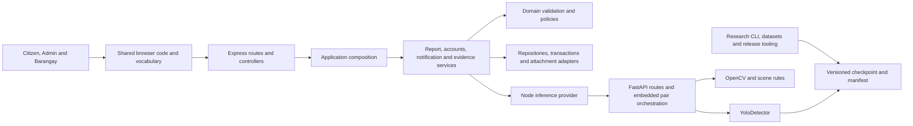
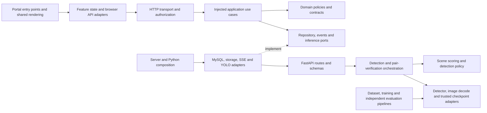

# NeighborLens AI modernization

2026-11-16 · `fine-tuning/neighborlens_final_v2/13-11-2026` · HEAD `14f742c`

## Baseline and inventory

The starting index had 74 staged paths, with no unstaged or untracked paths. This work is layered in the working tree without changing the index. [The source inventory](SOURCE_INVENTORY.json) records 547 tracked source and configuration files from the starting checkout, including 103 frontend files, 207 server files, 55 Python AI and test files, 57 scripts, and 101 additional test and support files. The repository had 4,754 tracked paths including datasets, binary weights, UI assets, and research artifacts.

The inventory includes file size in lines, identifier or responsibility area, exports and static imports where extractable, direct callers and test references, longest AST function, branch sites, and exception-handling or boundary flags. The branch metric counts decision sites and is independent of file length. Static references exclude dynamic browser globals and configuration resolution, so direct caller counts are a starting point for verification. All selected JavaScript and Python files parsed. The resolved static graph found no cycles. The eight static resolution flags come from Python namespace imports and one existing Barangay boundary data asset outside the source scan. Thirteen additional code-extension paths outside the scan are dataset and checkpoint YAML. [Source inventory](SOURCE_INVENTORY.json)

The prior [Python audit](../../ai/ARCHITECTURE_AUDIT.md) describes the original model adapter and Vercel problems. The starting checkout already has one `YoloDetector` per app, a pre-load manifest digest check, isolated packaging tests, and the Citizen required-field lock. The earlier Vercel test setup errors were absent from this baseline. The production Vercel checksum policy still pins YOLO11s.

| Evidence | Baseline |
| --- | --- |
| Python suite with real v9 fixtures | 200 passed, 1 skipped for the absent historical v2 dataset. All 11 real-model cases passed. |
| Full Node suite | 1,169 passed and 14 failed. Ten failures are in the admin account manager, one in client geofencing, and three in geofence reacquisition. |
| Phase 1B desktop and mobile | 20 passed. |
| FastAPI contract | Live and source-built OpenAPI matched on the five existing routes. Sorted compact JSON SHA-256 `415b6e204db95e36592bf34206894dec3812805c40fb19cf601be457514566b6`. |
| Model | YOLOv8m, version `neighborlens_yolov8m_v9`, release label `v9`, checkpoint `production/best.pt`. Canonical IDs 0 `broken_streetlight`, 1 `clogged_drainage`, 2 `pothole`, 3 `road_crack`. |
| Checkpoint SHA-256 | `6e55d6fec65531180e1655e1b3c5931101fbf96e23346dff272b29c5422cd3d2` |
| Manifest SHA-256 | `496e188ae54de7fad40b49c2d999bdcd5d01a1414a96831394a371cba9bba08c` |
| YOLO11s rollback SHA-256 | `f218ccde1a6d27455250fa40a6b38515170fba746512be7c10198fc46d1e6ef2` |

Fixture hashes and original HTTP bodies are in the [inference baseline](../../ai/ARCHITECTURE_BASELINE.json). The checkpoint records 66.815% validation mAP@0.5 at the selected epoch. Independent test evaluation is pending.

## Dependencies and active entry points

| Boundary | Entry point and dependencies |
| --- | --- |
| Browser | Nine HTML entry points served by Express locally and static routes on the website Vercel project. Shared UMD vocabulary and dates bridge browser and Node. Leaflet maps, chart rendering, local evidence-viewer code, and the browser media APIs stay at the UI boundary. |
| Node runtime | `npm run server` starts `server/app.js`. Root Vercel uses `api/index.js`, which exports the same Express app. HTTP uses Express, Multer and JWT. Composition assembles use cases and adapters. |
| Database and media | MySQL via `mysql2`, Supabase repositories and storage where configured, SQLite fixture adapter for tests. Sharp validates and fingerprints evidence. ExcelJS handles workbook export. Auth uses bcrypt and JWT. Migrations are checksum-checked and applied explicitly through the MySQL CLI. |
| Inference | `npm run ai` launches `python -m ai.inference.inference_api`; the Windows launcher retains direct script support. FastAPI, Uvicorn, Pillow, NumPy, OpenCV, Pydantic and Ultralytics/PyTorch. Node's local YOLO HTTP adapter and optional Roboflow adapter resolve endpoints through server config. The separate inference Vercel project stages an explicit Python and checkpoint allowlist plus authenticated inference routes. |
| Research | `ai/training/train_yolo.py` is the guarded training CLI. The v9 artifacts correspond to the baseline training path. Dataset lineage, integrity, annotation review and independent evaluation have separate entry points. Preserve provenance, seeds, frozen records, split format and the v9 release and rollback commands. |
| Validation | Node's built-in test runner, pytest, Playwright desktop/mobile, and private MySQL tests. CI is defined in `.github/workflows/qa.yml`. The PowerShell/Windows launcher and direct Python entry remain supported alongside the package script. |

### Current architecture

### Target architecture

## Severity and characterization matrix

| Priority | Finding and boundary | Characterization before further change |
| --- | --- | --- |
| High | The v9 release and pinned inference Vercel project differ. A remote build of the current checkpoint is deliberately gated. | Test the exact staged allowlist and its hash check in isolation. Review the remote artifact separately. |
| High | The Citizen suitability, near-duplicate, signature and geofence protections sit above raw Python inference. The golden Camo crop can still be classified by bare inference. | Keep Node authoritative. Require 422 before inference or writes for rejected evidence, and manual review for ambiguous or low-confidence evidence. |
| High | Report submission combines idempotency, proof verification, geofence, state, persistence and publication in one large use case. | Exercise duplicate retries, stale/incorrect proofs, authorized jurisdiction, transaction and event rollback, and manual-review flags against private MySQL before moving transaction logic. |
| High | Validation and test lineage differ across historical training workflows. The v9 run records no independent test-freeze digest. | Compare only provenance-equivalent runs. Test dataset overlap, split and label checks in temporary fixtures. Never rerun an independent test split for a refactor. |
| Medium | Direct infrastructure imports in `audit.service.js`, `auth.service.js`, and `citizenIdentity.service.js` bypass composition. | Establish a small port on audit first. Preserve portal roles, token expiry, timing-safe credential checks and identity independence in subsequent waves. |
| Medium | `inference_api.py` still combines scene scoring, OpenCV alignment, decode, manifest, and wire mapping. Async routes run synchronous inference and scene steps. | Extract pure scoring first. Keep the provider call order and existing timings as a later independent performance concern. |
| Medium | Browser state and rendering are intertwined in `citizen.js`, `admin_logic.js`, `reports.js` and `geofence.js`. Several clients rely on script ordering and window globals. | Preserve recorded disabled-submit states, asynchronous replacement generation, SSE behavior, report ownership, and desktop/mobile layouts. Cover recovery and watcher lifecycles before moving geofence state. |
| Medium | The full Node suite retains 14 existing failures. | Keep the same failure fingerprint visible. Investigate the admin and geofence tests in their own work so behavioral fixes receive explicit review. |
| Low | Older dataset audit and restratifier duplicate three AST-identical helpers. Legacy commands have external and historical callers. | Share only equivalent digest, pHash and Hamming primitives. Keep command paths and legacy output behavior. |

## Engineering conventions

- Keep policy separate from I/O. Inject dependencies at existing composition roots. Prefer functions for pure calculations and classes for resource ownership or state.
- Review a module around 400 lines or function around 60 lines for mixed responsibilities. Treat those as review prompts. Split along verified ownership boundaries.
- JavaScript uses current CommonJS and browser UMD patterns. Keep cross-runtime vocabulary versionable, escape dynamic UI text, and keep UI checks subordinate to server validation. Use syntax checks and Node/Playwright coverage for changed entry points.
- Python follows the surrounding PEP 8 style. Keep adapter boundaries typed where inputs or ownership are ambiguous. Protect serialized fields with pytest request contracts and real golden fixture checks. Retain direct-script and package imports where both are supported.
- CSS retains existing tokens, roles and selectors. Scope selectors and exercise mobile, desktop, light and dark where a touched rule affects them. Avoid unrelated formatting.
- Treat OpenAPI, model manifests, signed proof, database migrations and rollback artifacts as contracts. Use reviewed additive evolution for actual contract changes. Round model scores and serialize geometry at the existing boundaries.
- Use the current lockfile, protected environment configuration and verified migration checksums. Report failing tests with their baseline status. Run focused suites before broader tests and keep a change record per wave.

## Incremental roadmap

| Wave | First bounded extraction | Regression checkpoint |
| --- | --- | --- |
| A · Branding and baseline | Shared vocabulary resolves the actual v9 identifier to the public name. Citizen, saved report, and authorized staff details reuse that presentation. | Assert v9 display, historical identity preservation, stored raw identifier, OpenAPI equality, evidence rejection, SSE and role isolation. |
| B · Python pair logic | Extract pure scene scoring. Retain aliases, timestamps/UUID normalization, detector lifetime, embeddings and callers. | Full Python suite with golden fixtures and isolated Vercel package contract. |
| C · Node use-case boundary | Move audit repository binding into composition, then consider auth and identity ports after characterization. | Existing audit and admin list contracts, account activity, transaction error and auth/SSE tests. |
| D · Portal state | Extract Citizen submission readiness as pure policy, then isolate Admin filter/state and Barangay a feature at a time. | Browser evidence guards, geolocation and role routing on desktop/mobile. |
| E · Research tooling | Consolidate byte-identical hash/pHash helpers. Keep evaluation and train run orchestration and historical paths. | Dataset audit and restratifier characterization on fixtures. Keep raw and freeze digests fixed. |
| F · Legacy and quality | Review remaining static flags and CLI callers before removing verified duplicates. Add checks based on active constraints. | Reproduce historical entry points and exact public/runtime contracts before cleanup. |

## Wave A decision and change record

**Decision.** `shared/reportVocabulary.js` owns the public display name as presentation data. It recognizes the versioned v9 metadata and the exact historical spellings for the same artifact. Checkpoint, release label, architecture, inference response objects and per-photo signed model identity remain intact. Missing identity is shown as “Not reported” where the legacy scan view previously supplied a fallback. Historical models retain their recorded names. Admin uses its existing report header, while Barangay and Citizen use existing assessment facts. Printable and public-community output retain their current scope.

**Files.** `shared/reportVocabulary.js`, `frontend/js/citizen/damagePairAssessment.js`, `frontend/js/citizen/citizen.js`, `frontend/js/shared/reportPresentation.js`, `frontend/js/shared/reports.js`, `frontend/js/reports/reportDetailsView.js`, `server/tests/report-presentation.test.js`, `tests/support/phase-1b-browser-server.js`, `tests/browser/phase-2.spec.js`, `README.md`, `.gitignore`, and these two engineering artifacts.

**Responsibilities.** Model identity formatting now has one owner, shared across immediate and stored assessments. Rendering continues through existing portal and report components. No release or research artifacts were changed.

**Verification.** 125 focused Node tests and 16 desktop/mobile cases passed. They cover v9 and historical branding, raw model identity in stored proofs, duplicate and unsuitable evidence, required fields, pending manual review, authorization and SSE. FastAPI OpenAPI retained the baseline digest. The original 74 index entries are still staged. The wave is unstaged. Next is pure pair scene scoring.

## Wave B change record

**Files.** `ai/inference/inference_api.py`, `ai/inference/scene_scoring.py`, `ai/tests/test_scene_scoring.py`, `ai/tests/test_vercel_inference_entrypoint.py`, `inference-vercel/build.py`, `inference-vercel/README.md`.

**Responsibilities.** Pure cosine and advisory match scoring now have their own directly testable module. The API still owns image I/O, model call order, policy orchestration, and transport. The read-only build allowlist adds the scoring module and retains its pinned checkpoint.

**Verification.** 207 Python tests passed, including all 11 real-model cases, with the one historical dataset skip. The OpenAPI SHA-256 remained identical, and package and direct-script `--help` both passed. Changes are unstaged. The next Node slice is AI upload orchestration. The audit repository binding needs a separate migration because its singleton is shared by auth, identity, the bootstrap CLI and fault-injection tests.

## Wave C change record

**Files.** `server/application/use-cases/assessDamageUpload.js`, `server/composition.js`, `server/presentation/http/controllers/ai.controller.js`.

**Responsibilities.** The injected upload use case now chooses the assessment mode, checks evidence before inference, and coordinates batch ranking. The controller translates multipart input and preserves the ordered-preview response status and fields. Repository transactions, proof signing and the provider selection API are unchanged.

**Verification.** The same 67 contract, boundary, upload and correction tests passed before and after. Five private MySQL lifecycle tests passed through the extracted use case and a fresh real v9 process. Failures injected during the rollback test behaved as expected. Changes are unstaged. Next is Citizen submission readiness.

## Wave D change record

**Files.** `frontend/js/citizen/submissionReadiness.js`, `frontend/js/citizen/citizen.js`, `frontend/citizen.html`, `tests/integration/citizen-ai-frontend.test.js`, `tests/integration/citizen-location-state.test.js`.

**Responsibilities.** The pure readiness policy owns the upload state names, photo and result checks, and required field messages. The portal still owns DOM wiring, in-flight generations, geolocation and submission. Admin and Barangay rendering share the Wave A presentation adapter. Their larger state modules remain in the roadmap.

**Verification.** 65 focused Node cases and all 16 selected desktop/mobile cases passed. Evidence-first validation, removal, required fields, background assessment state, SSE and pending manual review remain covered. Changes are unstaged. Next is duplicate dataset hashing.

## Wave E change record

**Files.** `ai/preprocessing/dataset_hashes.py`, `ai/preprocessing/audit_yolo_dataset.py`, `ai/preprocessing/restratify_dataset_v2.py`.

**Responsibilities.** The two historical dataset tools now share the exact SHA-256, OpenCV DCT pHash and Hamming implementations. Each former module path still exports the helpers. The active scene-lineage implementation already uses a separate policy and retains it.

**Verification.** The original 37 focused characterization tests passed before extraction. The complete suite after extraction passed 207 tests with one historical-data skip and includes all 37 cases and the 11 real v9 fixtures. Both supported audit CLI launch styles passed `--help`, and the two historical modules expose the same helper objects. Only code was exercised with test fixtures. Changes are unstaged. Next is enforcing the extracted controller boundary.

## Wave F change record

**Files.** `.editorconfig`, `server/tests/architecture-boundaries.test.js`.

**Responsibilities.** EditorConfig sets scoped source indentation and newline conventions. The Node architecture suite enforces that the AI controller uses composition and has no direct import into application or infrastructure. Browser JavaScript keeps its local indent width. Existing CI runs the architecture test as part of the Node unit suite.

**Verification.** All 18 architecture checks passed, as did syntax checks for changed JavaScript and `git diff --check`. A separate desktop/mobile Chromium smoke used the actual refactored FastAPI process and temporary SQLite-backed Node app. Each client displayed the v9 brand, preserved the signed model identifier, and saved alternate-angle low-confidence evidence as a pending report with no confirmed detection. The original 74 paths are still staged. Modernization changes are unstaged.

The final full Node run finished with **1,172 passed, 14 failed, and 0 skipped**. All 14 failure names matched the initial baseline. The checkpoint, manifest, training source and YOLO11s archive SHA-256 values matched their starting values. The working delta contains 23 modified tracked files and 8 new source or documentation files. Production schema, research artifacts and remote configuration values retained their starting state.

## Measured changes

Counts are for ownership in the original file. Some statements moved into smaller modules, so these counts describe responsibility placement rather than the total volume of implementation.

| Original file | Lines before → after | AST decision sites before → after | New owner |
| --- | ---: | ---: | --- |
| `inference_api.py` | 454 → 440 | 44 → 39 | `scene_scoring.py` |
| `ai.controller.js` | 77 → 46 | 12 → 6 | Injected `assessDamageUpload.js` |
| `citizen.js` | 1,272 → 1,261 | 247 → 240 | `submissionReadiness.js` |
| `audit_yolo_dataset.py` | 354 → 335 | 43 → 41 | `dataset_hashes.py` |
| `restratify_dataset_v2.py` | 288 → 269 | 45 → 43 | Same dataset hash module |

## Prioritized remaining work

1. Characterize the separate admin account and geofence failures. Keep harness fixes separate from changes to role validation, geofence acceptance, and location watcher behavior.
2. Move the audit, auth and identity bindings together at the composition boundary, preserving transaction clients, existing import consumers, token expiry and login semantics. Then isolate report submission transaction phases behind the existing repository ports and characterize retries.
3. Extract the remaining Python pairing orchestration around the pure score. Preserve read/validation order and embed/alignment degradation. Review asynchronous scheduling and upload memory separately.
4. Use existing Admin and Barangay shared report components to isolate filters, permissions and state at the next natural boundary. Split style files only along measured feature boundaries. The current theme and report layouts are the visual reference.
5. Review historical research entry points with external callers and data owners before retiring any artifact. Preserve independent test eligibility and provenance. Remote inference rollout requires a separate pinned artifact decision and packaging validation.

The initial slices above are complete. The inventory is broad static coverage and the severity matrix documents inspected behavior and boundaries. Further per-file behavioral review and larger responsibility extractions remain.
