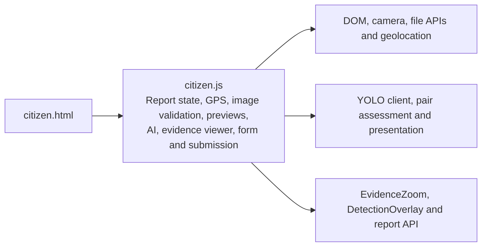
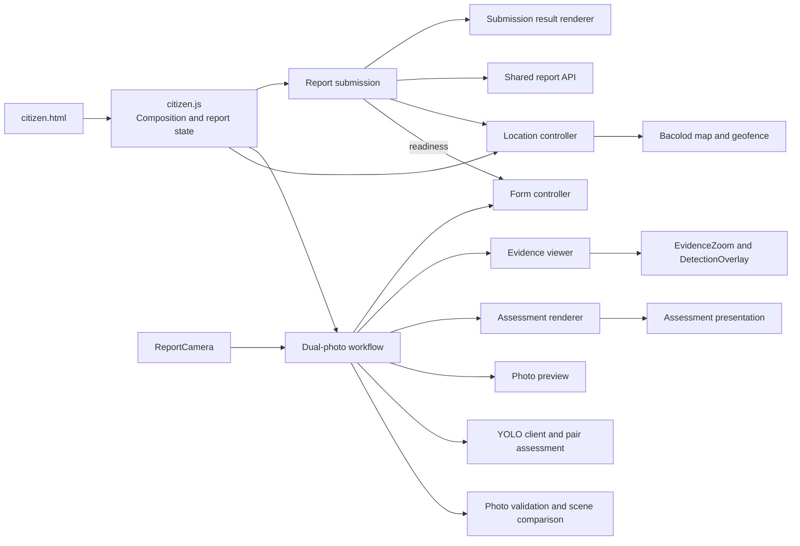

# Citizen Report refactor

The starting workspace had a 1,178-line `citizen.js`. It already included a separate assessment presentation module and a supplied 1,600 × 1,600 PNG. The entry point now has 95 lines, and the Citizen Portal uses the supplied PNG as its favicon. The browser test server served the asset with status 200 and content type `image/png`.

## Dependencies before and after





The form and submission callbacks are wired by the entry point. The form module has no script dependency on the submission module.

## File inventory and line counts

Paths in the table are under `frontend/js/citizen/`. A dash means the module did not exist in the starting workspace.

| File | Before | After | Responsibility |
| --- | ---: | ---: | --- |
| `citizen.js` | 1,178 | 95 | Composition, page lifecycle and report state |
| `assessmentRenderer.js` | — | 74 | Upload panel and assessment markup |
| `evidenceViewerController.js` | — | 215 | Enlarged preview, fullscreen fallback, zoom and overlays |
| `photoPreview.js` | — | 115 | Preview loading, photo count and object URLs |
| `photoValidation.js` | — | 72 | File type, decoding, dimensions and luminance checks |
| `photoWorkflow.js` | — | 166 | Selection, retake and generation-aware pair assessment |
| `reportFormController.js` | — | 150 | Categories, description and submission readiness |
| `reportLocation.js` | — | 101 | Location, map dialog and reset |
| `reportSubmission.js` | — | 160 | GPS validation, payload, retry key and submission lifecycle |
| `sceneComparison.js` | — | 37 | Advisory grayscale correlation |
| `submissionResultRenderer.js` | — | 66 | Success and error display |
| `citizenAssessmentPresentation.js` | 175 | 175 | Existing assessment copy, confidence and review details |
| `detectionOverlay.js` | 106 | 118 | Box projection, drawing and listener cleanup |

The size check runs with the Node integration suite. It limits the entry point to 100 lines and the listed feature modules to 200. Keeping the native fullscreen fallback, zoom and overlay cleanup in one controller warrants an exception capped at 300 lines.

**Added** The ten modules with a dash in the table and this QA report.

**Changed** `.gitignore`, `frontend/citizen.html`, `frontend/js/citizen/citizen.js`, `frontend/js/citizen/detectionOverlay.js`, `frontend/js/map/geofence.js`, `tests/browser/community-publication.spec.js`, `tests/browser/phase-1b.spec.js`, `tests/browser/phase-2.spec.js`, `tests/browser/report-details.spec.js`, `tests/browser/theme.cases.js`, `tests/integration/citizen-ai-frontend.test.js`, `tests/integration/citizen-location-state.test.js` and `tests/integration/geofence-reacquisition.test.js`.

**Deleted** None during the refactor. The supplied `frontend/assets/logo/neighborlens-logo.png` and the two older icon deletions were already in the starting workspace.

## State and lifecycle

- The entry point creates report state and passes it to the controllers that use it. The public handlers used by the page markup and the existing GPS helpers retain their names. Location, camera, preview URLs, zoom and submission request keys are owned by their respective controllers.
- A reset stops the GPS watcher and invalidates late GPS callbacks. Upload generations guard against outdated AI results, preview reads and submission acknowledgments.
- Preview replacement and reset release object URLs and close the old enlarged viewer. Closing the viewer disconnects its overlay observer and destroys its zoom instance. Overlay cleanup removes pending load listeners so a replacement image cannot receive the previous detection boxes.
- Dynamic assessment messages, submission metadata and geofence template text are escaped. Form errors and resolved address text use `textContent`.
- Image validation keeps the same luminance calculation and thresholds without retaining a per-pixel luminance array. The two decoded images also feed scene comparison. Submission reuses the assessment tied to the selected files and preserves their order.

## Verification

The YOLO adapter, scoring thresholds, bounding-box mapping, confidence bands, separate evidence verification, two-photo requirement, and report API payload remain compatible with the exercised workflows. The browser fixtures exercised matching and conflicting photos, stale responses, report corrections, zoom, retry, and Citizen, Admin and Barangay report access.

The Node baseline had 1,202 passes and three failures. The final run had 1,208 passes and the same three failures. `server/tests/report-presentation.test.js` expects the old YOLOv8 label, and two cases in `server/tests/submission-assessment.test.js` fail on existing suggestion and correction fixtures.

| Command | Result |
| --- | --- |
| `npm test` | 1,208 passed, 3 baseline failures |
| `node --test tests/integration/citizen-ai-frontend.test.js tests/integration/citizen-location-state.test.js tests/integration/client-geofence.test.js tests/integration/geofence-reacquisition.test.js` | 82 passed |
| `npm run test:e2e:browser` | 20 passed |
| `npm run test:e2e:phase2` | Baseline and final runs each passed all 64 cases, including iPhone-sized and Messenger user-agent WebKit projects |
| `npm run test:e2e:publication` | 14 passed |
| `npm run test:e2e:details` | 163 passed in the full run. The other seven passed on the targeted rerun after updating six theme assertions and waiting for Admin navigation to load before clicking the sidebar. |
| `.\.venv\Scripts\python.exe -m pytest ai/tests -q` | 216 passed, 14 skipped |

The targeted Report Details rerun passed all 10 cases, including both camera-to-Report Details cases.

```powershell
npx playwright test --config=playwright.community-regression.config.js report-details.spec.js --grep 'admin overview paginates|manages official accounts|citizen submits camera captures|theme: (light preserves|dark preserves|switching keeps)'
```

Browser camera and WebKit results come from test streams and device emulation. Physical iPhone and Messenger in-app verification remain outstanding. The Python run includes environment-gated model checks in its skips.

## Largest nearby files

The inventory uses physical lines, including blanks. It covers tracked feature modules and backend production code.

| Area | Largest files |
| --- | --- |
| Citizen | `notificationCenter.js` 445, `damagePairAssessment.js` 337, `reportCamera.js` 262 |
| Admin | `admin_logic.js` 1,440, `adminViewState.js` 59 |
| Barangay | `barangay.js` 87, `operations.js` 75, `reportListView.js` 57 |
| Backend use cases | `report.service.js` 630, `damageDetection.service.js` 465, `account.service.js` 434, `community.service.js` 427 |
